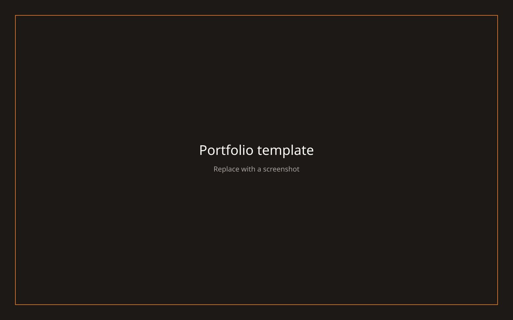

# Portfolio template

A Next.js App Router portfolio you can run with no database. Writings, projects, series, scribbles, and inspirations are fictional and point at example.com. The site URL, contact email, and social links in `content/profile.json` are Chimezie Innocent's (mezie.dev, Vic-Orlands).



Replace the image above with a screenshot after you personalize the site.

## Features

- Homepage with a portrait, writings, projects, series, and scribbles
- Article pages for writings, series, and works, plus tag pages
- Inspirations board
- RSS feed, sitemap, robots.txt, manifest, and Open Graph image
- Optional comments, contact form, and admin CMS
- Pluggable content: local files, Convex, or your own database

## Quick start

Requires Node.js and pnpm. No Convex account and no `.env` file.

```bash
pnpm install
pnpm dev
```

Open http://localhost:3000. The app reads `content/` because `CONTENT_SOURCE` defaults to `local`.

```bash
pnpm build
pnpm start
```

## Customizing content

| Edit this | To change |
| --- | --- |
| `content/profile.json` | Name, bio, email, socials, homepage intro, featured links |
| `content/publications.json` | "Published elsewhere" outlets |
| `content/posts/` | Writings (`.md`, `.mdx`, or `.json`) |
| `content/series/` | Series. Point posts at them with `series` and `partOrder` |
| `content/projects/` | Projects |
| `content/works/` | Scribbles and the works slider |
| `content/inspirations.json` | Inspiration bookmarks |
| `src/assets/homepage-profile.png` | Homepage photo |
| `public/` | Every other image, including the about portrait |

`src/lib/site.ts` exposes the profile to the layout, footer, SEO tags, RSS, and sitemap. Set `NEXT_PUBLIC_SITE_URL` to your real origin before you deploy.

Colors are the zinc page background (`#fafafa` / `#18181c`) and amber accents. Fonts are Instrument Serif plus the local Neue Haas files in `src/app/globals.css`. Navigation labels are in `src/components/portfolio/SideNavigation.tsx`.

A post looks like this:

```md
---
title: Quiet Interfaces
category: tech
description: One sentence used in lists and meta tags.
date: Jun 12, 2026
tags: design, writing
cover: /placeholders/cover.svg
---

The body is Markdown.
```

`category` is `tech`, `scriptures`, or `other`. Add `externalUrl` to link out instead of rendering the body. `status: draft` hides a file.

## Choosing a database

Pages call `getContentRepository()` from `src/lib/content`. They never import a database client.

### Local files

Default. Set nothing, or set `CONTENT_SOURCE=local`. Markdown, MDX, and JSON in `content/` are the source of truth. MDX is rendered as Markdown.

### Convex

Optional backend, comments, and admin CMS.

```bash
npx convex dev
```

Put the printed URL in `.env.local`:

```bash
CONTENT_SOURCE=convex
NEXT_PUBLIC_CONVEX_URL=https://<deployment>.convex.cloud
ADMIN_ENABLED=true
```

Set `ADMIN_PASSWORD` in the Convex dashboard, then open `/admin`. Seed the sample catalog (it does not contain personal data):

```bash
npx convex run seed:seedTemplate
```

If you serve images from Convex or object storage, add that hostname to `IMAGE_REMOTE_HOSTS`. Do not commit a private host.

### Your own adapter

`CONTENT_SOURCE=custom` loads `src/lib/content/adapters/custom.ts`, which throws until you implement it. `src/lib/content/adapters/sql.example.ts` sketches Drizzle, Prisma, and Supabase against Postgres, SQLite, or Supabase. Implement `ContentRepository` there, keep pages on the interface, and install the client library you chose.

## Deploying on Vercel

1. Import the repository.
2. Leave `CONTENT_SOURCE` unset or set it to `local` if you are shipping the files in `content/`.
3. Set `NEXT_PUBLIC_SITE_URL` to the production origin, including `https://`.
4. Framework preset: Next.js. Install command: `pnpm install`. Build command: `pnpm build`.
5. Deploy. Local mode does not need Convex environment variables.

For Convex in production, set `CONTENT_SOURCE=convex`, `NEXT_PUBLIC_CONVEX_URL`, and `ADMIN_ENABLED=true`, and run the Convex production deploy from the [Convex docs](https://docs.convex.dev/production). Add `RESEND_API_KEY`, `CONTACT_FROM_EMAIL`, and `CONTACT_TO_EMAIL` only if you want the contact form to send mail.

## Environment variables

Copy `.env.example` to `.env.local`.

| Variable | Required | Purpose |
| --- | --- | --- |
| `CONTENT_SOURCE` | No | `local` (default), `convex`, or `custom` |
| `NEXT_PUBLIC_SITE_URL` | Production | Canonical URL for SEO, RSS, and the sitemap |
| `NEXT_PUBLIC_CONVEX_URL` | Convex only | Convex deployment URL |
| `CONVEX_DEPLOYMENT` | Convex only | Written by the Convex CLI |
| `ADMIN_ENABLED` | No | `true` enables `/admin` when Convex is selected |
| `ADMIN_PASSWORD` | Convex admin | Password you choose, set in Convex, not in git |
| `RESEND_API_KEY` | Contact form | Resend API key |
| `CONTACT_FROM_EMAIL` | Contact form | Verified sender |
| `CONTACT_TO_EMAIL` | No | Inbox. Defaults to the profile email |
| `NEXT_PUBLIC_ANALYTICS_SRC` | No | Tracker script URL. Omit to disable analytics |
| `NEXT_PUBLIC_ANALYTICS_SITE_ID` | No | `data-site-id` passed to that script |
| `IMAGE_REMOTE_HOSTS` | No | Comma-separated hostnames for remote images |
| `R2_*` | Uploads | Optional object storage for the admin uploader |

## Using an AI agent

Point the agent at [AGENTS.md](./AGENTS.md). It lists every file that owns a piece of the site, how to swap the data source, and what to leave alone. `CLAUDE.md` points at the same guide.

Paste this, then fill in the blanks:

```text
Personalize this portfolio for me.

Name: <full name>
Short name: <name used in the manifest>
Email: <email>
Site URL: https://<domain>
GitHub: https://github.com/<handle>
LinkedIn: https://www.linkedin.com/in/<handle>
X: https://x.com/<handle>
Twitter handle: @<handle>

Role: <one line, used as the tagline and job title>
Homepage intro: <the sentence on the portrait button, then one or two sentences after it>
About: <two short paragraphs>
Location label: <text on the about portrait, or "LOC // CITY">

Replace the homepage photo with the image I will add at src/assets/homepage-profile.png.
Replace the about portrait with a file I will add under public/, and point content/profile.json aboutPortrait at it.

Featured work:
- <name> — <url> — <one line> — image at public/<file>
- <name> — <url> — <one line> — image at public/<file>

Writings to add (create content/posts files, remove the sample posts):
- <title> — <date> — <category: tech|scriptures|other> — <one sentence>

Series:
- <title> — parts: <post slugs in order>

Projects (content/projects, remove the samples):
- <name> — <url> — <date> — <one sentence>

Scribbles (content/works):
- <name> — <category: 3D|Grid|Card> — <one sentence>

Inspirations: replace content/inspirations.json with <list or "I'll paste URLs">.
Publications: replace content/publications.json with <outlet, url, one line>.

Keep CONTENT_SOURCE=local unless I say otherwise.
Do not add analytics, private hostnames, or a database.
Do not change the layout system, cursor, or scribble demos.
```

## Scripts

- `pnpm dev` — Next.js with Turbopack on port 3000
- `pnpm build` / `pnpm start` — production
- `pnpm lint` — TypeScript
- `pnpm dev:backend` — `convex dev` (optional)
